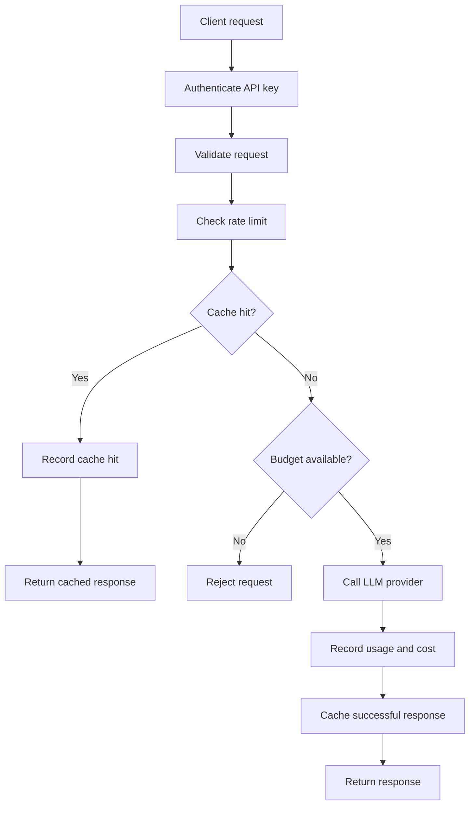
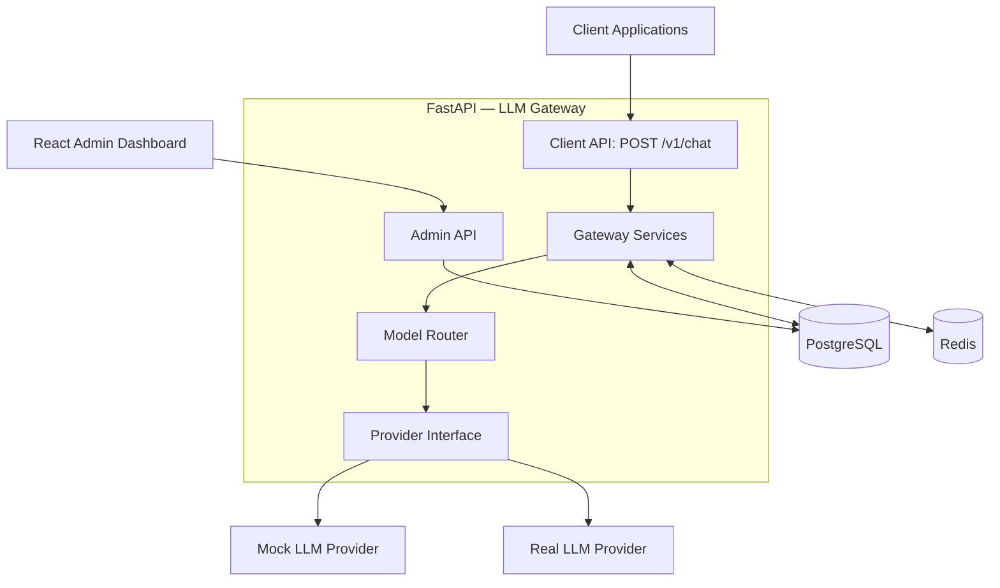
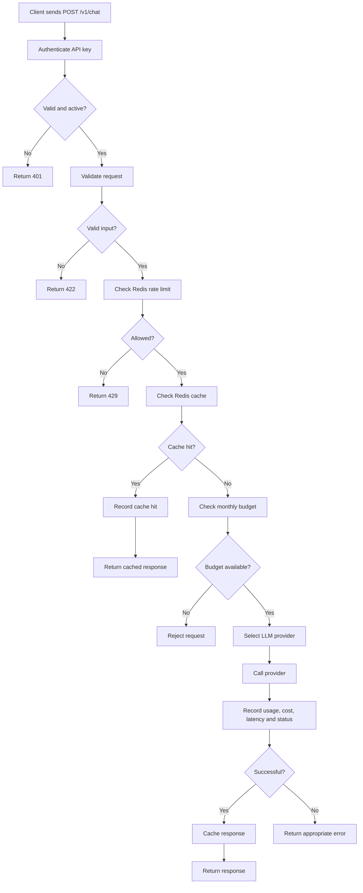

# LLM Gateway — System Design

1. Problem

When multiple applications within an organisation use LLM providers directly, each application may need to independently handle concerns such as authentication, usage controls, rate limiting, and usage tracking. This creates duplicated logic and makes it difficult for the organisation to centrally understand which applications are making requests, how much they are using, and how much they cost. Applications can also become coupled to provider-specific APIs and configurations, meaning that changing or adding an LLM provider may require changes across multiple applications. As the number of AI applications grows, managing these concerns independently becomes increasingly difficult.

2. Goals

- Centralise LLM provider integrations so client applications do not need to implement provider-specific integrations independently.
- Authenticate client applications and control access to the gateway using API keys.
- Track LLM usage and estimated cost for each project.
- Record request information such as token usage, latency and success or failure to provide visibility into LLM usage.
- Enforce configurable rate limits to prevent individual API keys from sending excessive numbers of requests.
- Track spending and enforce configurable monthly budgets for each project.
- Cache exact requests so repeated requests can reuse a previous response when appropriate, reducing unnecessary provider calls, cost and latency.

3. Out of Scope for V1

The following are intentionally outside the scope of V1:

- **Semantic caching and embeddings** — V1 will only support exact-response caching. Semantic similarity introduces additional complexity that is not necessary to demonstrate the gateway concept.
- **Billing and payments** — the gateway will track estimated LLM costs and enforce budgets, but it will not charge customers or process payments.
- **Public signup** — V1 is a portfolio/demo system rather than a public SaaS product with self-service registration.
- **Hosting or fine-tuning LLMs** — the gateway integrates with external LLM providers rather than operating models itself.
- **Background workers** — V1 does not currently have workloads that justify introducing a separate asynchronous job-processing system.
- **Kubernetes or multi-region deployment** — these solve infrastructure and scaling problems that our V1 does not yet have.
- **Advanced provider resilience** — provider fallback, retries and a more sophisticated timeout strategy are deferred until after the core gateway works.

4. Users

The system has direct and indirect users.

### Client applications

Client applications are direct system actors. Each application or project authenticates with its own API key and sends LLM requests through the gateway rather than communicating directly with an LLM provider.

### Admins / developers

Admins and developers are direct human users. They use the admin dashboard to manage projects and API keys, configure limits and budgets, and monitor usage, costs, latency and errors.

### End users

End users are indirect users, such as customers or employees using an AI-powered application. They interact with the client application rather than with the LLM gateway directly. The gateway does not authenticate individual end users in V1.

5. V1 Requirements

### Chat Requests

- The gateway must expose an endpoint that client applications can use to submit chat requests.
- Client applications must authenticate requests using an API key.
- The gateway must validate incoming requests before forwarding them.
- The gateway must determine the appropriate provider based on the requested model.
- The gateway must forward valid requests to the appropriate LLM provider.
- The gateway must return the LLM response to the client application.

### Multi-tenancy

- The system must support multiple organisations as separate tenants.
- Each organisation can contain multiple projects representing different client applications or workloads.
- Each project can have its own API keys.
- Requests authenticated with an API key must be associated with the project that owns that key.
- Projects, API keys, usage and configuration belonging to one organisation must be isolated from other organisations.

### API Key Authentication

- Client applications must authenticate gateway requests using an API key.
- API keys must belong to a project.
- API keys must be unique and securely generated.
- Raw API keys must not be stored by the gateway; only a secure representation of each key must be persisted.
- The raw API key must only be shown when the key is created.
- Invalid or revoked API keys must not be allowed to access protected gateway endpoints.

### Usage Tracking

- The gateway must record each LLM request so usage can be attributed to the appropriate project.
- Usage records must include input and output token counts when available.
- The gateway must calculate and record the estimated cost of each request.
- The gateway must record request latency and whether the request succeeded or failed.
- Failed provider requests must also be recorded so failures can be monitored.
- Usage data must support understanding usage and cost at the project level.

### Rate Limiting

- The gateway must support configurable rate limits for API keys.
- The gateway must check the applicable rate limit before forwarding a request to an LLM provider.
- Requests that exceed the configured rate limit must be rejected without calling the LLM provider.
- Rate-limited clients must be able to make requests again when the applicable limit allows them.

### Monthly Budgets

- Projects must support a configurable monthly spending budget.
- Before forwarding a request to an LLM provider, the gateway must check the project's recorded spending for the current month.
- If recorded spending has reached or exceeded the project's monthly budget, the request must be rejected without calling the LLM provider.
- Successful provider usage must update the project's recorded monthly spending.

For V1, budget enforcement is based on recorded spending before a request begins. Because the final output token count and exact request cost are not known until the provider responds, a request that begins below the budget may cause actual spending to slightly exceed the configured limit. Subsequent requests will then be rejected.

### Exact-response Caching

### Cache and Budget Behaviour

- Authentication, request validation and rate limiting must happen before checking the cache.
- The gateway must check for an existing cached response before checking the monthly spending budget.
- A valid cache hit may be returned even when the project has exhausted its monthly budget.
- On a cache miss, the gateway must check the project's monthly budget before calling the LLM provider.
- Cached requests must still count towards the API key's rate limit.
- Cache hits must be recorded for usage visibility without counting them as new LLM-provider spending.

**Trade-off:** Projects can continue using previously cached responses after exhausting their monthly budget, but cannot make new provider requests until their budget allows it.

### V1 Request Pipeline

### Admin Dashboard

- Admins must be able to view and manage organisations and their projects.
- Admins must be able to create projects within an organisation.
- Admins must be able to generate and revoke API keys for projects.
- Newly generated API keys must be displayed only once.
- Admins must be able to configure API-key rate limits and project monthly budgets.
- Admins must be able to view usage statistics, estimated costs, request counts, latency and errors.
- Admins must be able to inspect request history for individual projects.
- The dashboard must communicate with the gateway backend through an Admin API.
- Access to organisation data must be restricted to authorised administrators.

## Non-functional Requirements

### Security and Data Isolation

- The backend must enforce authentication and authorisation independently of the frontend.
- Users must only be able to access organisations and resources they are authorised to access.
- Client API keys must not grant administrative permissions.
- API keys and provider credentials must be protected from unauthorised access.
- Data belonging to different organisations must remain logically isolated.

### Reliability

- The gateway must handle LLM provider failures without crashing.
- The gateway must return appropriate HTTP error responses when requests cannot be completed.
- Provider failures must be recorded so administrators can investigate them.
- Error responses must not expose sensitive information such as API keys or provider credentials.

### Performance

- The gateway should minimise additional latency introduced by authentication, rate limiting, budget checks and usage tracking.
- Cached responses should avoid unnecessary calls to LLM providers.
- The gateway must record request latency to help identify performance problems.

### Observability

- The gateway must record useful information about successful and failed LLM requests.
- Each request should have a unique request identifier to help with debugging.
- Error records should identify the type of failure without exposing sensitive information.
- Administrators should be able to inspect request counts, latency, errors and estimated costs.

### Rate Limiting Availability

The gateway will fail closed when Redis rate limiting is unavailable.
Requests will be rejected with HTTP 503 rather than forwarded to the LLM provider without rate-limit checks.
This prioritises cost protection over availability.
The trade-off is that legitimate requests may be temporarily rejected during Redis outages.

### Provider Abstraction

The gateway will use a shared provider interface.

Each provider implementation will handle its own authentication, request formatting and response mapping.

The main chat endpoint will interact with providers through this interface rather than containing provider-specific API logic.

V1 will include a mock provider and one real LLM provider.

### Model Routing

Clients specify the model they want to use, without needing to specify the LLM provider.

The gateway maps supported model identifiers to provider implementations.

Unsupported models are rejected before any provider call.

V1 uses a simple model-to-provider mapping.

## High-Level Architecture

Client applications communicate with the gateway through the Chat API, while administrators use a React dashboard that communicates with a separate Admin API. FastAPI handles authentication, authorisation and gateway business logic. PostgreSQL stores persistent data, Redis handles rate limiting and temporary caching, and a provider abstraction allows the gateway to communicate with different LLM providers.

## Complete Lifecycle

